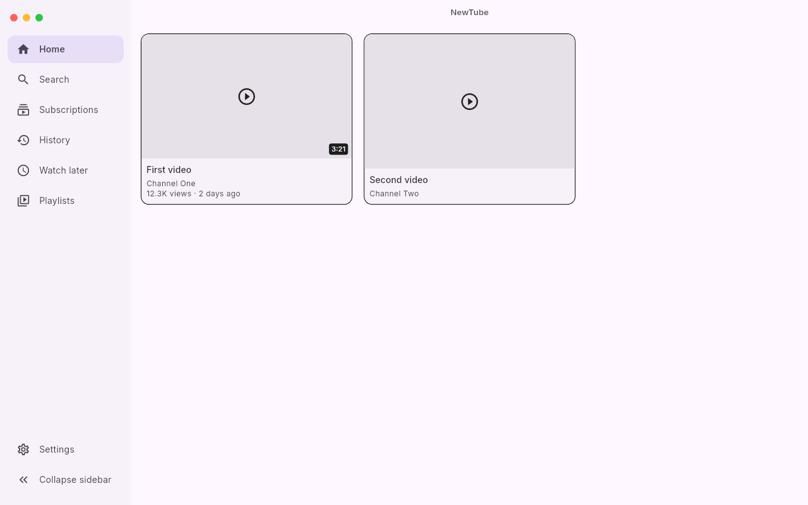
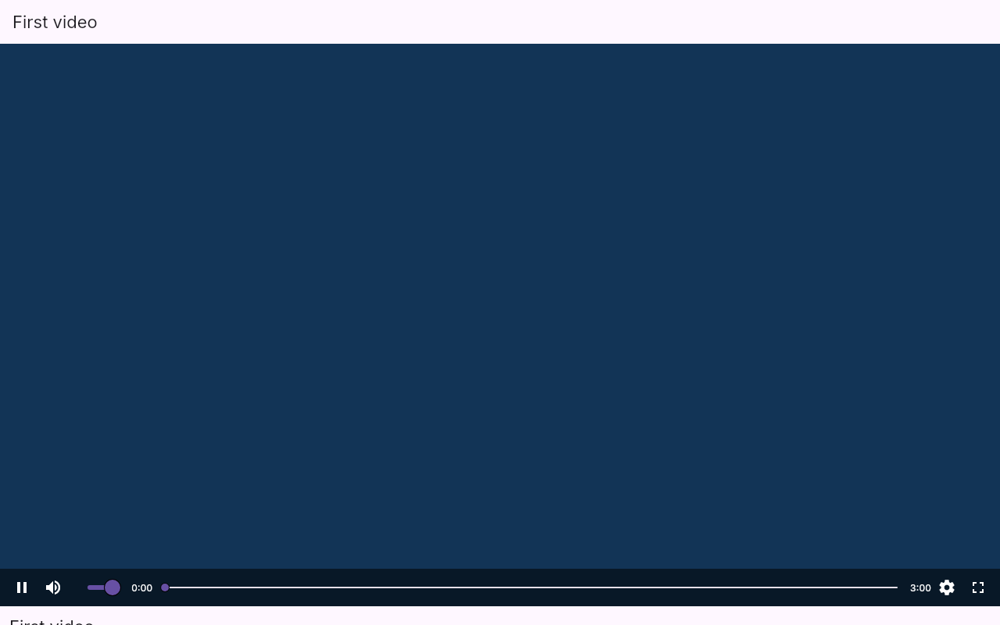
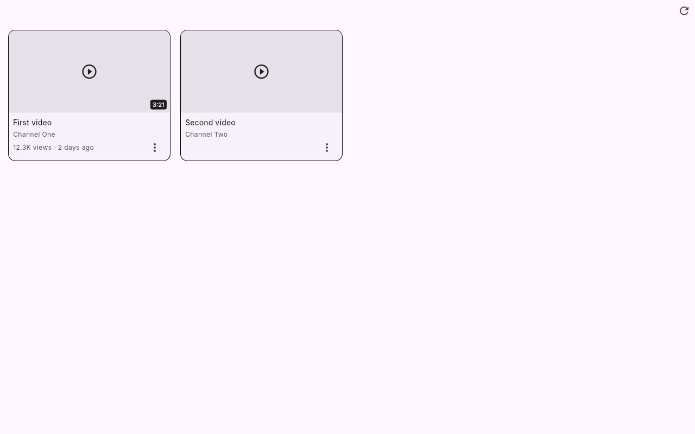

# NewTube

A privacy-friendly YouTube client for desktop and mobile. Watch videos
without the ads, the tracking or the clutter: your subscriptions and
history stay on your device.

[](https://gitlab.com/HttpAnimations/newtube/-/pipelines)
[](https://gitlab.com/HttpAnimations/newtube/-/releases)
[](https://www.gnu.org/licenses/agpl-3.0.html)
[](https://httpanimations.gitlab.io/newtube/)

## What it does

- Watch YouTube videos with a real player: quality selection, audio-only
  mode and proper fullscreen.
- Subscribe to channels without an account. Your subscriptions live on
  your device, not in the cloud.
- Search videos and channels, browse channel uploads and keep a local
  watch history.
- Runs on Android, iOS, Linux, Windows and macOS, plus a web version.
- Checks itself for updates straight from the releases page.

## Get it

The [landing page](https://httpanimations.gitlab.io/newtube/) has
screenshots and one-click downloads for every platform, or grab the files
directly from the [releases page](https://gitlab.com/HttpAnimations/newtube/-/releases):

- **Android**: `.apk` or `.aab`
- **iOS**: `.ipa` via the AltStore source below
- **Linux**: AppImage, Flatpak repo, `.deb`, `.rpm`, `.zip`
- **Windows / macOS**: `.zip`
- **Web**: [httpanimations.gitlab.io/newtube/app/](https://httpanimations.gitlab.io/newtube/app/)

The web build needs a little help to reach YouTube, since browsers block
cross-site requests. Either install a CORS extension
([Firefox](https://addons.mozilla.org/en-US/firefox/addon/cors-everywhere/),
[Chrome](https://chromewebstore.google.com/detail/allow-cors-access-control/lhobafahddgcelffkeicbaginigeejlf))
or set a CORS proxy prefix in Settings. For local development a small proxy
is included: run `node scripts/dev/cors_proxy.mjs`, then point the prefix at
the address it prints plus `?u=`.

### AltStore source (iOS)

Add this source in AltStore to install and update NewTube:

```
https://gitlab.com/HttpAnimations/newtube/-/raw/main/repos/altstore.json
```

### Flatpak (Linux)

```
flatpak remote-add newtube https://httpanimations.gitlab.io/newtube/flatpak
flatpak install newtube gitlab.httpanimations.newtube
```

### MCP server (Linux, Windows, macOS)

Settings can turn on a local
[Model Context Protocol](https://modelcontextprotocol.io) server at
`http://127.0.0.1:8642/mcp` (Streamable HTTP, loopback only). It lets AI
clients search YouTube, read channel and video details and play videos in
the app. Clients that only support stdio servers can reach it through a
bridge such as `npx mcp-remote http://127.0.0.1:8642/mcp`.

With the server on, Settings can export a `.mcpb` file containing a
standard `mcpServers` config through the native save dialog. Merge the
entry into your client's MCP configuration (`mcp.json`,
`claude_desktop_config.json` and so on). The same document can be
written to disk without the app running:

```
dart run tool/export_mcpb.dart newtube.mcpb
```

## Screenshots





## Source and licence

Source of truth lives on [GitLab](https://gitlab.com/HttpAnimations/newtube);
a mirror on [GitHub](https://github.com/justacalico/newtube) runs the builds
and the compiled releases come back to GitLab.

NewTube is free software licensed under the
[GNU Affero General Public Licence v3.0](LICENSE).
